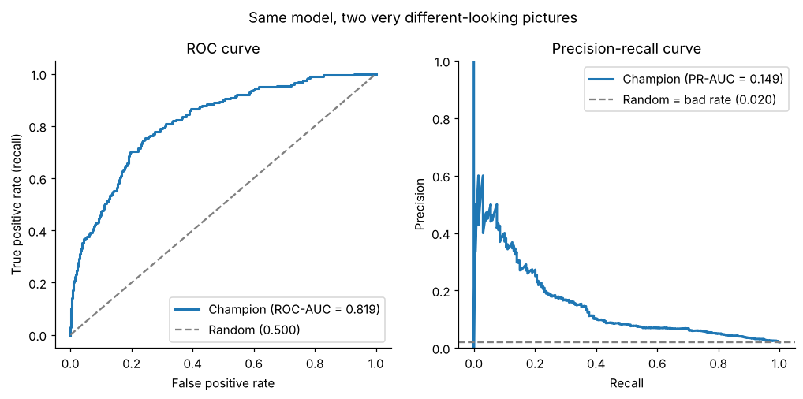
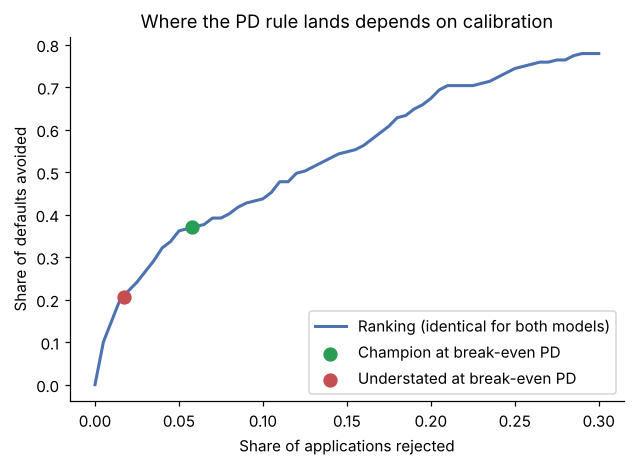

# credit-scoring-validation

Validation toolkit for credit scoring (probability-of-default) models on **imbalanced data**, with a two-step model-risk classification that turns validation results into a decision: what the model may be used for.

It implements the methodology from

> A. Tkatchev, I. Kogoleva. **Beyond Standard Metrics: Comprehensive Validation of Credit Scoring Models.** *Bankovsky Vestnik* (National Bank of the Republic of Belarus), No. 8 (757), August 2026, pp. 42–52. [PDF of the issue](https://www.nbrb.by/bv/pdf/journals/757.pdf) (in Russian)

and a [worked notebook](notebooks/validation_walkthrough.ipynb) that validates a model end to end on synthetic data.

## Why

When defaults are 1–3% of a portfolio, ROC-AUC can look good while the model misses most defaults: its false-positive rate divides by thousands of good borrowers, so false alarms barely move it. PR-AUC does not have that cushion — but a random model scores the bad rate, so it has to be read as a **multiple of the bad rate**.



Discrimination is also only half the question. A model can keep exactly the same ROC-AUC and PR-AUC while its PDs become unusable for a PD-based cut-off, provisioning or capital. Calibration has to be validated separately.

## The two-step classification

**Step 1 — veto factors.** Any breach rejects the model.

| Criterion | Veto if |
|---|---|
| PR-AUC lift (PR-AUC / bad rate) | < 2× |
| Calibration slope | < 0.3 or > 2.0 |
| PSI, development vs. current scores | > 0.50 |
| Capture rate, riskiest 10% | < 15% |

**Step 2 — penalties.** Each criterion is scored green / yellow / red.

| Criterion | Green | Yellow | Red |
|---|---|---|---|
| ECE | < 0.05 | 0.05–0.10 | > 0.10 |
| Brier score | below naive *p(1−p)* | equal to naive | above naive |
| Capture rate, top 20% | > 45% | 35–45% | < 35% |
| PSI | < 0.10 | 0.10–0.25 | 0.25–0.50 |
| Calibration slope | 0.8–1.2 | 0.5–0.8 or 1.2–1.5 | outside, within veto bounds |

**Result — model-risk class.**

| Class | Verdict | Main conditions | Allowed use |
|---|---|---|---|
| A | Approved, full trust | lift ≥ 5×, slope 0.8–1.2, ECE < 0.05, top-20% capture > 45%, ≤ 1 yellow | Automatic PD-based cut-off, IRB, economic capital |
| B | Approved with limitations | lift ≥ 5×, slope 0.5–1.5, ECE < 0.10, top-20% capture > 35%, ≤ 2 yellow | PD-based cut-off with quarterly monitoring |
| C | Conditionally approved | lift ≥ 3×, ≤ 1 red | Quantile cut-off only, PDs not used, recalibration plan |
| D | Weak, temporary use | lift ≥ 2×, ≤ 2 red | Expert support only, limited lifetime |
| E | Rejected | any veto, lift < 2× or 3+ red | Not allowed in production |

All thresholds are configurable through `scoreval.Thresholds`.

## Quick start

```bash
git clone https://github.com/<your-username>/credit-scoring-validation.git
cd credit-scoring-validation
pip install -e ".[dev]"
pytest
```

```python
import scoreval as sv

verdict = sv.validate(y_test, pd_test, reference_pd=pd_dev)
print(verdict.summary())
```

```
Class A: Approved, full trust
  PR-AUC 0.149 = 7.48x baseline (Good); ROC-AUC 0.819
  Vetoes: none
  Penalties: 0 yellow, 0 red
  Observed/expected defaults: 0.99 (p = 0.972)
  Why: all class A conditions met
  Allowed use: Automatic PD-based cut-off; suitable for IRB use and economic capital.
```

`y_test` is a 0/1 default flag, `pd_test` the predicted PDs on the validation sample and `pd_dev` the PDs on the development sample (used for PSI; optional).

## What the notebook shows

Six models validated side by side on the same synthetic test set (10,000 loans, 2% defaults):

| Scenario | ROC-AUC | PR-AUC lift | Slope | Obs/exp | Class |
|---|---|---|---|---|---|
| Champion (logistic regression) | 0.819 | 7.5× | 0.98 | 0.99 | **A** |
| Same ranking, overconfident PDs | 0.819 | 7.5× | 0.61 | 0.60 | **C** |
| Same ranking, PDs halved | 0.819 | 7.5× | 0.98 | 1.91 | A (see below) |
| Champion on drifted applicants | 0.841 | 7.1× | 1.11 | 1.03 | A, PSI yellow |
| Gradient boosting, raw | 0.787 | 4.0× | 0.64 | 1.08 | **C** |
| Gradient boosting, isotonic-calibrated | 0.781 | 3.4× | 0.85 | 1.09 | **C** |

* Distorting the PDs while keeping the ranking leaves ROC-AUC and PR-AUC untouched; only the calibration criteria catch it.
* Isotonic calibration removes all calibration penalties from the gradient-boosting model, but cannot fix its weaker ranking.
* **Halved PDs keep class A** under the published criteria: the calibration slope is blind to a uniform shift, and an absolute ECE threshold of 0.05 is wide at a 2% bad rate. `scoreval` therefore also reports **observed / expected defaults** with a binomial test, and can count it as a penalty with `Thresholds(count_oe=True)`.

The notebook also back-tests cut-off strategies: a PD-based rule at the break-even PD versus a quantile rule that rejects a fixed share of the riskiest applications.



## Package contents

| Module | What it does |
|---|---|
| `scoreval.metrics` | ROC-AUC, Gini, KS, PR-AUC and lift, capture rate, Brier, ECE, calibration slope, observed/expected, Hosmer–Lemeshow, binomial test by grade, stratified bootstrap CIs |
| `scoreval.stability` | PSI with per-bin breakdown |
| `scoreval.risk_tiering` | Veto checks, penalty scoring, class A–E with reasons |
| `scoreval.cutoff` | Break-even PD, PD-based and quantile cut-off back-tests |
| `scoreval.data` | Synthetic loan portfolio with a low default rate and optional drift |

## Implementation notes

Choices where the article leaves room for interpretation:

* **Calibration slope** — slope of a logistic regression of the outcome on logit(PD).
* **ECE** — 10 equal-frequency PD bins; equal-width bins put almost all low PDs into one bin.
* **Brier "equal to naive"** — within ±1% of *p(1−p)*.
* **Class assignment** — classes are tried from A to E and the model gets the first one whose conditions it meets. A model with lift ≥ 5× that fails class B falls to C.
* **Absolute PR-AUC > 0.5** (the last row of the article's penalty table) — reported but not counted by default, because at low default rates almost every model fails it, including those the article's own examples rate as class A.

## Data

All data in this repository is **synthetic** (`scoreval.data.make_credit_portfolio`). No data, code or models from any bank are included. To use real data, pass any 0/1 default flag and predicted PDs — for example from the public Kaggle *Give Me Some Credit* or *Home Credit Default Risk* datasets.

## Author

**Iulia Kogoleva** — model risk and data science in banking. [LinkedIn](https://www.linkedin.com/in/iulia-kogoleva)

Released under the [MIT License](LICENSE).
